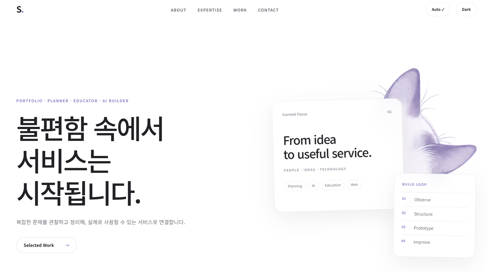
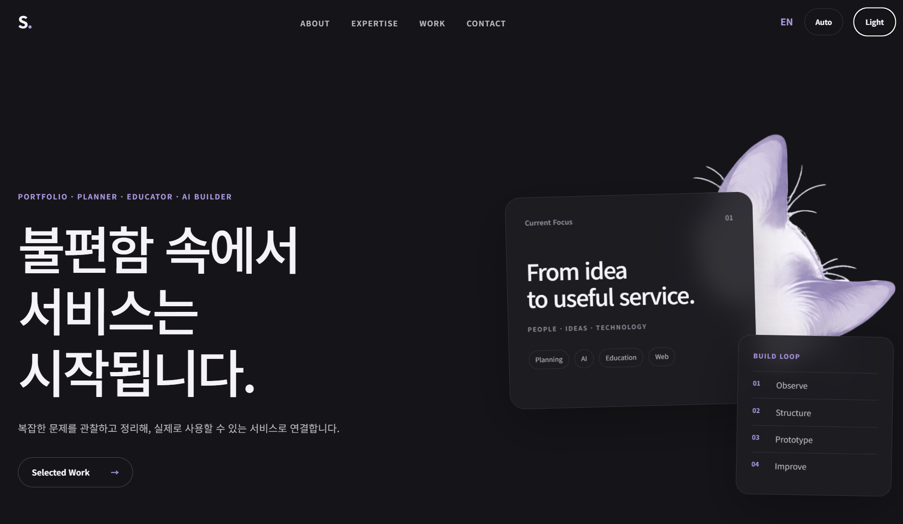
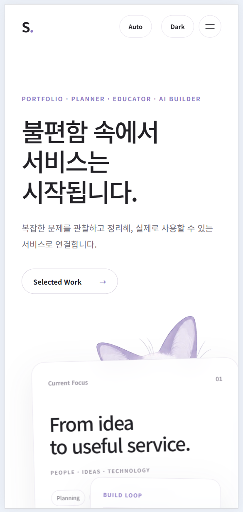
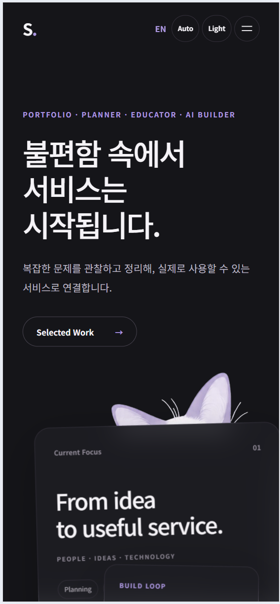

# Codyssey B1-1 | Personal Portfolio

> 사람의 불편을 발견하고, 아이디어를 실제 서비스로 연결하는 개인 포트폴리오 웹사이트

- **배포 사이트:** https://beatles12.github.io/codyssey-b1-1-portfolio/
- **GitHub 저장소:** https://github.com/beatles12/codyssey-b1-1-portfolio
- **개발 방식:** 순수 HTML · CSS · JavaScript (프레임워크 없이 구현)

## 목차

1. [프로젝트 소개](#1-프로젝트-소개)
2. [화면 구성과 사용 방법](#2-화면-구성과-사용-방법)
3. [기술 스택과 선택 이유](#3-기술-스택과-선택-이유)
4. [파일 구조와 역할](#4-파일-구조와-역할)
5. [HTML 구조와 접근성](#5-html-구조와-접근성)
6. [CSS와 반응형 설계](#6-css와-반응형-설계)
7. [JavaScript 전체 동작 구조](#7-javascript-전체-동작-구조)
8. [주요 기능별 실행 흐름](#8-주요-기능별-실행-흐름)
9. [비동기 통신과 GitHub API](#9-비동기-통신과-github-api)
10. [입력 검사와 문의 전송](#10-입력-검사와-문의-전송)
11. [ES6+ 주요 문법](#11-es6-주요-문법)
12. [핵심 함수 찾아보기](#12-핵심-함수-찾아보기)
13. [직접 실행 및 기능 확인](#13-직접-실행-및-기능-확인)
14. [스크린샷과 배포](#14-스크린샷과-배포)
15. [설계 의도와 개선 방향](#15-설계-의도와-개선-방향)

---

## 1. 프로젝트 소개

교육·상담·서비스 기획 경험을 바탕으로, 사용자 문제를 발견하고 서비스로 연결하는 과정을 소개하는 웹사이트입니다. **Hero → About → Expertise(Skills) → Work(Projects) → Contact → Footer** 순서로 구성했습니다.

핵심 학습 목표는 예쁜 화면을 만드는 것만이 아니라 **사용자 이벤트 → 상태 변경 → DOM 업데이트 → 화면 변화**를 이해하고 직접 구현하는 것입니다.

이 사이트는 React, Vue, jQuery 등의 프레임워크 없이 HTML·CSS·JavaScript로 구현했습니다.

## 2. 화면 구성과 사용 방법

| 위치 | 화면에 보이는 내용 | 주요 기능 |
| --- | --- | --- |
| **Hero** | 포트폴리오의 주제와 소개 문구 | `Selected Work` 버튼으로 프로젝트 이동, 제목 타이핑 |
| **About** | 소개 글과 프로필 이미지 | 화면에 들어올 때 등장 효과 |
| **Expertise / Skills** | 기획·AI·개발·커뮤니케이션 역량 | 반응형 카드 |
| **Work / Projects** | 실제 GitHub 저장소 기반 프로젝트 | 비동기 로딩, 카드 표시, 기술별 필터, 저장소 링크 |
| **Contact** | 이름·이메일·메시지 입력 | 입력 검사, 오류 안내, Formspree 전송 |
| **Footer** | 저작권, GitHub 프로필, 위로 이동 링크 | 외부 프로필 연결, 맨 위로 이동 |

상단 메뉴에서 각 영역으로 이동할 수 있으며, 화면 폭이 좁아지면 메뉴가 햄버거 버튼 형태로 바뀝니다. 테마는 Light/Dark/Auto 방식, 언어는 KR/EN 방식으로 전환합니다.

## 3. 기술 스택과 선택 이유

| 기술 | 역할 | 사용 이유 |
| --- | --- | --- |
| **HTML5** | 웹페이지의 뼈대 | 각 영역의 의미를 구조적으로 표현 |
| **CSS3** | 색상·배치·반응형 디자인 | 화면 크기와 테마에 맞춘 스타일 적용 |
| **JavaScript ES6+** | 사용자 동작과 화면 변화 | 버튼, 폼, API, 상태 처리 |
| **GitHub REST API** | GitHub 저장소 정보 제공 | 프로젝트 목록을 실제 데이터로 생성 |
| **Formspree** | 문의 메시지 접수 | 별도 서버 없이 문의 전송 기능 구현 |
| **GitHub Pages** | 웹사이트 공개 | 정적 사이트를 인터넷에 배포 |
| **Live Server** | 로컬 개발 실행 | 저장한 내용을 브라우저에서 확인 |

**DOM(Document Object Model)**은 HTML을 JavaScript가 찾고 바꿀 수 있게 나타낸 문서 구조입니다. **이벤트(Event)**는 클릭·입력·스크롤처럼 사용자가 일으키는 동작입니다. **렌더링(Rendering)**은 현재 데이터에 맞춰 화면 내용을 보여주는 일입니다.

## 4. 파일 구조와 역할

```text
codyssey-b1-1-portfolio/
├── index.html          # 화면의 구조와 콘텐츠
├── css/
│   └── style.css       # 디자인, 테마, 반응형, 애니메이션
├── js/
│   ├── i18n.js         # 한국어/영어 문구와 언어 전환
│   └── script.js       # 상태, 이벤트, GitHub API, 폼, 효과
├── images/             # 프로필, 장식, 카드 이미지, 화면 캡처
├── README.md           # 프로젝트 및 기술 설명서
└── .gitignore          # Git에서 추적하지 않을 파일 목록
```

`index.html`의 `<script src="js/i18n.js" defer>`와 `<script src="js/script.js" defer>`는 자바스크립트 파일을 연결합니다. **`defer`**는 HTML을 읽는 동안 파일을 준비하되, HTML 분석이 끝난 뒤 실행하도록 돕습니다.

`js/i18n.js`를 먼저 연결하므로 언어 관련 기능을 `js/script.js`에서 사용할 수 있습니다.

## 5. HTML 구조와 접근성

**시맨틱 태그(Semantic Tag)**란 사용 목적이 이름에 드러나는 HTML 태그입니다.

| 태그 | 홈페이지에서 맡은 역할 |
| --- | --- |
| `<header>` | 상단 영역 또는 섹션의 제목 영역 |
| `<nav>` | About·Expertise·Work·Contact 메뉴 |
| `<main>` | 홈페이지의 주요 콘텐츠 |
| `<section>` | Hero·About·Skills·Projects·Contact 구역 |
| `<article>` | 독립적으로 의미가 있는 정보 카드 |
| `<footer>` | 저작권·GitHub 링크·맨 위로 이동 |

**시맨틱 태그를 쓴 이유:** 코드를 읽는 사람과 브라우저 보조 기술이 각 영역의 의미를 이해하기 쉽도록 하기 위해서입니다.

- **앵커 링크:** `<a href="#projects">`로 같은 페이지의 Projects 구역으로 이동합니다.
- **이미지 대체 텍스트:** `alt`로 이미지 내용을 글로 설명합니다.
- **입력 항목 안내:** `<label for="email">`과 `<input id="email">`을 연결합니다.
- **접근성 속성:** `aria-label`, `aria-expanded`, `role="status"`로 버튼의 목적과 현재 상태를 설명합니다.

## 6. CSS와 반응형 설계

### 색상과 테마

- `:root`에는 공통 색상·간격·글꼴 등 **CSS 변수**를 선언합니다.
- `[data-theme="dark"]`에는 다크모드용 변수값을 따로 정의합니다.
- JavaScript가 HTML 요소의 `data-theme` 값을 바꾸면 관련 CSS 변수도 변경됩니다.

### Flexbox와 Grid

- **Flexbox:** 상단 메뉴처럼 항목을 **한 방향으로 정렬**하는 데 적합합니다. 실제 `.navigation`에 적용했습니다.
- **Grid:** 프로젝트 카드처럼 항목을 **행과 열로 배치**하는 데 적합합니다. 실제 `.project-list`에 적용했습니다.

### 모바일 퍼스트와 화면 너비

먼저 모바일 기본 레이아웃을 정한 후 `@media`로 화면이 넓어졌을 때의 규칙을 추가했습니다.

**모바일 퍼스트(Mobile First)란?**

휴대폰처럼 작은 화면을 먼저 설계하고, 화면이 커질 때 필요한 디자인을 추가하는 방식입니다.

**모바일 퍼스트를 선택한 이유**

1. 작은 화면에서는 공간이 부족하므로 중요한 내용을 먼저 정리할 수 있습니다.
2. 모바일 기본 디자인을 만든 뒤 태블릿과 PC용 규칙을 추가하면 화면별 관리가 편리합니다.
3. 같은 홈페이지를 휴대폰, 태블릿, PC에서 모두 편리하게 사용할 수 있습니다.

**실제 적용 방법**

- 기본 CSS: 모바일 화면을 기준으로 작성
- `@media (min-width: 768px)`: 태블릿 화면에 맞는 배치 적용
- `@media (min-width: 1024px)`: PC 화면에 맞는 배치 적용
- `auto-fit`과 `minmax()`: 화면 공간과 카드 개수에 맞게 프로젝트 카드 배치

**설계 핵심**

작은 화면부터 필요한 내용을 정리하고, 화면이 넓어질수록 레이아웃을 확장하도록 설계했습니다.

| 화면 너비 | 프로젝트 카드 배열 | 관련 CSS |
| --- | --- | --- |
| 768px 미만 | 기본 1열 | `.project-list` 기본 스타일 |
| 768px 이상 | 공간에 맞춰 자동 배치, 일반적인 태블릿 폭에서 2열 | `repeat(auto-fit, minmax(315px, 1fr))` |
| 1024px 이상 | 공간에 맞춰 자동 배치, 충분히 넓으면 4열 | `repeat(auto-fit, minmax(200px, 1fr))` |

`auto-fit`은 들어갈 수 있는 만큼 열 수를 조절하고, `minmax(200px, 1fr)`은 각 열을 최소 200px로 하면서 남는 공간을 나눠 씁니다. 카드 수가 적거나 창이 좁으면 열 개수는 달라질 수 있습니다.

**카드가 하나만 표시될 때:** Docker 필터처럼 프로젝트가 1개만 남으면 `:only-child`로 해당 카드를 선택하고 `max-width: 320px`을 적용해 카드가 화면 전체로 늘어나지 않도록 했습니다. 이 규칙은 화면 너비 768px 이상에서 적용됩니다.

### 시각 효과

버튼·카드에 `hover`와 `transition`을 적용하고, 카드에 `box-shadow`를 활용했습니다. `.reveal`과 `.reveal.visible`로 화면 진입 시 투명도와 위치가 전환되도록 구성했습니다. 현재 로컬 보완 기준 이동 거리 **40px**, 전환 시간 **1.1초**입니다.

사용자가 기기에서 움직임 최소화 설정을 켠 경우 `prefers-reduced-motion: reduce` 규칙으로 전환·애니메이션을 줄입니다.

## 7. JavaScript 전체 동작 구조

```text
사용자 행동 (클릭·스크롤·입력)
       ↓
addEventListener (이벤트 감지)
       ↓
우리 프로젝트에서 만든 함수 실행
       ↓
필요하면 STATE 객체의 값 변경
       ↓
render...() 함수 또는 DOM 직접 갱신
       ↓
화면에 결과 표시
```

현재 프로그램의 주요 상태를 담는 `STATE` 객체는 다음 항목을 관리합니다.

| STATE 속성 | 뜻 |
| --- | --- |
| `theme` | 현재 테마(`light` 또는 `dark`) |
| `themeSource` | 시스템 자동 설정인지 사용자가 직접 선택했는지 |
| `menuOpen` | 모바일 메뉴가 열려 있는지 |
| `projects` | GitHub에서 가져와 보관 중인 프로젝트 |
| `filter` | 현재 적용한 프로젝트 필터 |
| `formErrors` | 문의 폼의 항목별 오류 메시지 |

**STATE는 객체(Object)**입니다. 관련 정보를 한 상자에 모아 관리하지만, 이 프로젝트가 `class`를 중심으로 만들어진 것은 아닙니다. 기능은 주로 별도의 함수로 구성했습니다.

### STATE 객체를 사용한 이유

**상태(State)**란 홈페이지의 현재 상황을 뜻합니다.

우리 홈페이지에서는 다음 정보를 `STATE` 객체 하나에 모아 관리합니다.

- `theme`: 현재 화면의 테마
- `menuOpen`: 모바일 메뉴가 열렸는지 여부
- `projects`: GitHub에서 가져온 프로젝트 목록
- `filter`: 현재 선택한 프로젝트 필터
- `formErrors`: 문의 입력란의 오류 정보

**왜 별도의 STATE 객체를 만들었을까?**

관련 정보를 여러 변수에 흩어 놓지 않고 하나의 객체로 묶으면 현재 상태를 파악하고 관리하기 쉽기 때문입니다.

**실제 실행 흐름 — 다크모드 예시**

Dark 버튼 클릭
→ `toggleTheme()` 실행
→ `STATE.theme` 변경
→ `renderTheme()` 실행
→ 화면 테마 변경

**중요한 점**

`STATE`의 값을 변경한다고 화면이 자동으로 바뀌지는 않습니다. 변경된 값을 화면에 적용하는 `renderTheme()` 같은 함수가 필요합니다.

**설계 이유**

사용자 동작, 상태 변경, 화면 갱신의 역할을 구분하여 코드를 이해하고 수정하기 쉽게 구성했습니다.

### onclick과 addEventListener의 차이

**이벤트(Event)**는 클릭, 입력, 스크롤처럼 사용자나 브라우저에서 발생하는 동작입니다.

- `onclick`: 클릭했을 때 실행할 함수를 지정하는 방식입니다. HTML 속성이나 JavaScript 속성으로 사용할 수 있습니다.
- `addEventListener()`: JavaScript에서 이벤트를 감지하고 함수를 연결하는 브라우저 기본 기능입니다. 같은 이벤트에 여러 함수를 등록할 수도 있습니다.

**실제 적용 코드 — `js/script.js`**

`themeToggle.addEventListener("click", toggleTheme);`

- `themeToggle`: Dark/Light 버튼
- `"click"`: 클릭 이벤트
- `toggleTheme`: 클릭하면 실행되는 프로젝트 함수

**실행 흐름**

Dark/Light 버튼 클릭 → `toggleTheme()` 실행 → `STATE.theme` 변경 → `renderTheme()` 실행 → 화면 색상 변경

**설계 이유**

HTML은 화면 구조를 담당하고, JavaScript는 동작을 담당하도록 분리하기 위해 `addEventListener()`를 사용했습니다. 기능을 관리하고 수정하기 쉽기 때문입니다.

**핵심 설명:** "우리 홈페이지는 HTML과 JavaScript의 역할을 분리하기 위해 addEventListener를 사용했습니다."


## 8. 주요 기능별 실행 흐름

### 8-1. 다크모드와 설정 저장

```text
Dark / Light 버튼 클릭
 → toggleTheme()
 → STATE.theme, STATE.themeSource 변경
 → localStorage에 사용자 선택 저장
 → renderTheme()
 → data-theme 변경 → CSS 테마 변경
```

- **`localStorage`**는 브라우저에 값을 저장해 새로고침 후에도 다시 읽을 수 있는 기본 기능입니다.
- 첫 실행 시 `getInitialTheme()`은 사용자가 저장한 수동 설정이 있으면 이를 사용하고, 아니면 컴퓨터 시스템 테마를 따릅니다.
- **Auto 버튼**은 수동 저장을 해제해 시스템 테마 적용으로 돌아갑니다.

### 8-2. 모바일 햄버거 메뉴

```text
메뉴 버튼 클릭
 → toggleMenu()
 → STATE.menuOpen 변경
 → renderMenu()
 → 메뉴의 active 클래스 변경 및 aria-expanded 갱신
```

메뉴 항목을 선택하면 `closeMenu()`가 메뉴를 닫습니다.

### 8-3. 스크롤과 등장 효과

- **60px 이상:** `handleScroll()`이 상단 메뉴에 `scrolled` 클래스를 붙이고 배경색을 변경합니다.
- **300px 이상:** `handleScroll()`이 맨 위로 이동하는 버튼에 `visible` 클래스를 붙입니다.
- **버튼 클릭:** `scrollToTop()`이 `window.scrollTo({ top: 0, behavior: "smooth" })`를 실행합니다.
- **등장 효과:** `startRevealAnimation()`은 `IntersectionObserver`로 `.reveal` 영역을 관찰합니다. **임계값 `threshold: 0.2`**, 즉 관찰 대상의 약 20%가 보이는 시점에 `visible` 클래스를 붙이도록 설정했습니다.
- **제목 타이핑:** `startHeadingTyping()`은 큰 제목을 감지해 별도의 한 글자씩 표시하는 효과를 시작합니다. 이것은 영역 등장 효과와 다른 기능입니다.

`IntersectionObserver`는 HTML 요소가 화면에 들어왔는지 관찰하는 **브라우저 기본 기능**입니다. `startRevealAnimation()`은 그 기능을 활용해 **우리가 만든 함수**입니다.

### 8-4. 한국어/영어 전환

```text
KR / EN 버튼 클릭
 → applyLanguage()
 → LANGUAGE_CONTENT에서 선택한 언어의 문구 가져오기
 → 화면의 텍스트 갱신
 → localStorage에 언어 선택 저장
 → 필요하면 프로젝트 카드 문구 다시 표시
```

`js/i18n.js`의 `LANGUAGE_CONTENT`에 언어별 문구를 정리했습니다. Footer에서는 `href="#hero"`인 링크를 구분하여 맨 위로 이동하는 링크 문구만 변경합니다.

### 8-5. 프로젝트 카드 및 필터

```text
필터 버튼 클릭
 → STATE.filter 변경
 → renderProjectFilters()
 → renderProjects()
 → filter()로 조건에 맞는 프로젝트 선택
 → map(createProjectCard)로 카드 HTML 생성
 → innerHTML로 화면 갱신
```

프로젝트는 사용자 저장소 정보를 바탕으로 만들며, 선택한 프로젝트에 한해 설명·기술·스크린샷을 보완해 보여줍니다. 프로젝트 카드의 링크는 실제 GitHub 저장소로 연결됩니다.

## 9. 비동기 통신과 GitHub API

**비동기(Asynchronous)** 는 인터넷 응답을 기다리는 동안 프로그램 전체를 멈추지 않고 작업할 수 있게 하는 방식입니다.

**async / await / fetch의 역할**
- `async`: 비동기 함수를 선언하는 JavaScript 문법입니다.
- `fetch()`: 인터넷 서버에 데이터를 요청하는 함수입니다.
- `await`: 비동기 작업이 끝날 때까지 해당 함수의 다음 작업을 기다립니다. 이때 브라우저 전체가 멈추지는 않습니다.

`js/script.js`의 `loadProjects()`에서 다음 GitHub API를 호출합니다.

```text
https://api.github.com/users/beatles12/repos?sort=updated&per_page=100
```

```text
loadProjects() 실행
 → "불러오는 중" 표시
 → fetch()로 GitHub에 요청
 → await로 응답 기다리기
 → response.ok 검사
 → response.json()으로 데이터 읽기
 → fork 및 archived 저장소 제외
 → 우선순위대로 정렬 후 최대 4개 선택
 → STATE.projects 저장
 → 필터 버튼과 카드 표시
```

### 네 가지 화면 상태

| 상태 | 조건 | 사용자에게 보여주는 결과 |
| --- | --- | --- |
| **Loading** | API 응답 대기 | 프로젝트를 불러오는 중이라는 문구 |
| **Success** | 유효한 프로젝트가 있음 | 프로젝트 카드 및 필터 |
| **Empty** | 표시할 프로젝트가 없음 | 표시할 프로젝트가 없다는 안내 |
| **Error** | API 요청/처리 실패 | 오류 안내 및 `다시 시도` 버튼 |

`try/catch`는 요청 중 오류를 처리하고, 오류 상태에서는 `renderProjectError()`가 재시도 버튼을 만듭니다. 이 버튼을 누르면 `loadProjects()`를 다시 실행합니다.

GitHub API를 로그인 없이 호출하는 경우 요청 횟수 제한이 있으므로 짧은 시간에 지나친 새로고침을 피합니다. 요청 제한 등으로 오류 응답이 오면 오류 화면으로 처리하도록 작성했습니다.

## 10. 입력 검사와 문의 전송

Contact에는 **이름·이메일·메시지** 세 가지 입력란이 있습니다.

```text
Send Message 클릭
 → handleFormSubmit(event)
 → event.preventDefault()로 기본 제출 동작 중지
 → validateForm()으로 빈칸과 이메일 형식 검사
 → STATE.formErrors에 결과 보관
 → renderFormErrors()로 입력란 옆에 안내 표시
 → 오류가 있으면 전송하지 않고 종료
 → 오류가 없으면 Formspree로 POST 요청
 → 성공/실패 안내, 버튼 상태 복구
```

- `validateEmail()`은 이메일의 기본적인 형식을 검사합니다.
- `validateField()`는 입력 중 또는 포커스를 벗어날 때 해당 입력값을 다시 확인합니다.
- **POST**는 서버에 데이터를 보내는 HTTP 요청 방식입니다.
- 메시지 전송에는 외부 Formspree 서비스가 사용되며, 인터넷 연결과 서비스 상태에 영향을 받습니다.

## 11. ES6+ 주요 문법

| 코드에 사용된 문법 | 쉬운 설명 | 실제 사용 위치 |
| --- | --- | --- |
| `const` | 다시 다른 값을 대입하지 않을 변수 선언 | `STATE`, 각 DOM 요소 참조 |
| `let` | 나중에 값을 바꿔야 할 변수 선언 | 타이핑 진행 상태 처리 |
| `() => {}` | 화살표 함수: 작업을 정의하는 문법 | `toggleTheme`, `loadProjects` 등 |
| `` `${name}` `` | 템플릿 리터럴: 글 속에 변수 넣기 | 카드 HTML, GitHub API 주소 |
| `{ name, language } = project` | 구조분해 할당: 객체에서 필요한 정보 꺼내기 | `createProjectCard()` |
| `map()` | 배열의 각 항목을 다른 형태로 바꾸기 | 프로젝트 → 카드 HTML |
| `filter()` | 조건에 맞는 항목만 고르기 | 언어·기술별 프로젝트 선택 |
| `forEach()` | 배열의 항목을 하나씩 순회하기 | 필터 버튼, 입력 오류, 관찰 대상 등록 |
| `async/await` | 인터넷 응답 등 비동기 작업 처리 | `loadProjects`, `handleFormSubmit` |
| `try/catch` | 실패할 수 있는 작업과 오류 대응 | API 불러오기, 문의 전송 |

아래 한 줄은 **현재 프로젝트의 실제 코드**입니다.

```javascript
projectList.innerHTML = projects.map(createProjectCard).join("");
```

1. `projects`에 여러 프로젝트가 들어 있습니다.
2. `map(createProjectCard)`가 프로젝트 하나씩 카드 HTML로 바꿉니다.
3. `join("")`가 만들어진 HTML 문자열을 이어 붙입니다.
4. `innerHTML`이 화면의 프로젝트 목록을 변경합니다.

## 12. 핵심 함수 찾아보기

VS Code에서 **`Ctrl + F`**를 누른 뒤 함수 이름으로 검색하면 실제 구현 위치를 찾을 수 있습니다.

| 기능 | 주요 함수 | 하는 일 |
| --- | --- | --- |
| 테마 | `getInitialTheme`, `toggleTheme`, `renderTheme` | 초기 설정 확인, 테마 변경, 화면 적용 |
| 시스템 테마 | `syncSystemTheme`, `handleSystemThemeChange` | 시스템 설정 반영 |
| 모바일 메뉴 | `toggleMenu`, `closeMenu`, `renderMenu` | 메뉴 열기·닫기·화면 반영 |
| 스크롤 | `handleScroll`, `scrollToTop` | 스크롤 위치에 따른 화면 변화 |
| 프로젝트 자료 | `sortPreferredProjects`, `loadProjects` | GitHub 데이터 요청 및 정렬 |
| 프로젝트 카드 | `createProjectCard`, `getProjectVisual`, `renderProjects` | 카드 HTML 생성과 출력 |
| 프로젝트 필터 | `renderProjectFilters`, `renderProjects` | 필터 버튼 생성 및 목록 변경 |
| 오류 대응 | `renderProjectError` | API 실패 메시지와 재시도 버튼 |
| 안전한 HTML | `escapeHtml` | 외부 데이터에 포함된 HTML 특수문자 변환 |
| 폼 검사 | `validateEmail`, `validateForm`, `validateField` | 입력값 검사 |
| 폼 화면·전송 | `renderFormErrors`, `handleFormSubmit` | 오류 표시 및 Formspree 요청 |
| 프로필 이미지 | `handleProfileImage` | 이미지 오류 시 기본 디자인 표시 |
| 글자 효과 | `prepareTypingParts`, `typeHeading`, `startHeadingTyping` | 제목 타이핑 |
| 영역 등장 효과 | `startRevealAnimation` | IntersectionObserver로 영역 등장 처리 |
| 다국어 | `getWorkText`, `getLocalizedProjectDescription`, `applyLanguage` | 언어별 텍스트 적용 (`js/i18n.js`) |

참고: JavaScript의 `querySelector`, `addEventListener`, `fetch`, `map`, `filter`, `forEach`는 브라우저나 JavaScript 환경이 제공하는 기본 기능입니다. `toggleTheme`, `loadProjects` 등의 이름은 **이 프로젝트에서 직접 만든 함수**입니다.

## 13. 직접 실행 및 기능 확인

### 로컬 실행

1. VS Code에서 `codyssey-b1-1-portfolio` 프로젝트 폴더를 엽니다.
2. Live Server 확장 기능으로 `index.html`을 실행합니다.
3. Chrome 브라우저에서 사이트가 열리는지 확인합니다.
4. 코드를 수정할 때마다 저장 후 화면을 다시 확인합니다.

### 점검 항목

아래 표는 **직접 확인할 방법**이며, 표에 적혀 있다고 자동으로 테스트 완료가 되는 것은 아닙니다.

| 확인 기능 | 확인 방법 | 기대 결과 |
| --- | --- | --- |
| 화면 크기 | PC / 태블릿 / 모바일 너비로 보기 | 글·카드가 잘리지 않음 |
| 모바일 메뉴 | 좁은 화면에서 메뉴 버튼 누르기 | 열기·닫기 가능 |
| 테마 저장 | Dark 선택 후 새로고침 | 선택한 테마 유지 |
| 시스템 테마 | Auto 선택 후 시스템 설정 변경 | 시스템 테마 따라감 |
| 언어 전환 | KR / EN 버튼 누르기 | 주요 문구가 전환됨 |
| 앵커 이동 | About·Work 등 메뉴 클릭 | 해당 구역으로 부드럽게 이동 |
| 헤더 배경 | 페이지를 60px 이상 내리기 | 상단 배경색 변경 |
| 맨 위 버튼 | 페이지를 300px 이상 내리고 버튼 클릭 | 버튼 표시 후 맨 위로 이동 |
| 영역 등장 | 새로고침 후 About 등으로 이동 | 등장 애니메이션 확인 |
| API 성공 | Work로 이동 | GitHub 기반 카드 표시 |
| API 실패 | 네트워크 제한 상황에서 확인 | 오류 안내와 재시도 표시 |
| API 빈 목록 | 빈 데이터를 가정해 확인 | 빈 목록 안내 |
| 필터 | All, Python, Docker 등 선택 | 조건에 맞는 카드 표시 |
| 문의 오류 | 입력을 비우거나 이메일을 잘못 쓰고 제출 | 필드별 오류 메시지 표시 |
| 오류 해제 | 잘못된 이메일을 올바르게 고치기 | 오류 메시지 사라짐 |
| 실제 문의 | 테스트용 유효 데이터를 전송 | 전송 성공 또는 실패 메시지 확인 |
| Footer | GitHub 링크와 Back to top 클릭 | 각각 올바른 곳으로 이동 |

실제 전송 테스트는 Formspree에 메시지가 접수될 수 있으므로 테스트용 데이터로 진행합니다. API 실패 및 빈 목록처럼 재현하기 어려운 상태는 코드 점검과 별도의 재현 테스트를 구분해 확인합니다.

## 14. 스크린샷과 배포

### 데스크톱

| 라이트 모드 | 다크 모드 |
| :---: | :---: |
|  |  |

### 모바일

| 라이트 모드 | 다크 모드 |
| :---: | :---: |
|  |  |

- **실행 사이트:** https://beatles12.github.io/codyssey-b1-1-portfolio/
- **소스 코드:** https://github.com/beatles12/codyssey-b1-1-portfolio

GitHub Pages는 저장소에 올린 정적 HTML·CSS·JavaScript 파일을 웹사이트로 공개합니다. **로컬에서 수정한 파일은 `push`하기 전까지 배포 사이트에 자동으로 반영되지 않습니다.**

## 15. 설계 의도와 개선 방향

### 설계 이유

1. **파일 역할 분리:** HTML 구조, CSS 디자인, JavaScript 동작을 분리해 읽고 고치기 쉽게 했습니다.
2. **상태와 화면 구분:** `STATE`에 현재 값을 모으고 `render...()` 함수로 화면에 반영했습니다.
3. **실제 데이터 사용:** 프로젝트를 HTML에 고정 작성하는 대신 GitHub API에서 가져옵니다.
4. **오류도 화면에 표시:** API·폼 사용 중 잘못된 입력이나 통신 실패에 안내를 제공합니다.
5. **반응형·접근성 고려:** 여러 화면 너비, 대체 텍스트, 입력 레이블과 버튼 상태를 고려했습니다.

### 현재 구조의 한계와 향후 개선

- 프로젝트 데이터는 GitHub API 제공 상태와 요청 제한의 영향을 받습니다.
- 실제 문의 전송은 Formspree 외부 서비스의 연결 상태에 영향을 받습니다.
- 복잡한 작업이 많아지면 기능별 JavaScript 모듈 분리와 자동화 테스트 도입을 고려할 수 있습니다.
- 애니메이션은 실행 여부뿐 아니라 실제 화면에서의 체감 효과와 접근성 설정을 함께 확인해야 합니다.

---

**Codyssey B1-1 | Personal Portfolio**
